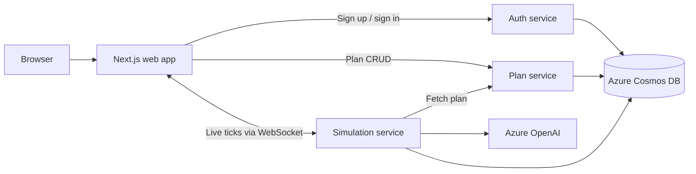

# Myriox

**Autonomous, multi-agent site and flow simulation for accessibility, compliance, and bottleneck analysis.**

Myriox lets teams turn a floor plan into a navigable grid, send distinct user personas through it, and inspect where routes fail in practice. It combines LLM-directed movement with deterministic movement validation, then produces a visual bottleneck report and code-grounded accessibility findings.

[Watch the demo](https://youtu.be/t_e-CtLxn_Q) · [Read the architecture](docs/architecture.md) · [Review the personas](docs/personas.md)

> Myriox is a prototype decision-support tool. Its compliance output is not a substitute for review by a qualified architect, accessibility specialist, or authority having jurisdiction.

## What it does

- **Create a plan** — paint a grid with walls, doors, ramps, stairs, elevators, service points, entries, exits, and named zones. You can trace over a compressed reference-image overlay.
- **Model different people** — run a mix of five built-in personas: rushed commuter, wheelchair user, parent with stroller, delivery worker, and elderly visitor.
- **Simulate movement live** — each active persona uses an Azure OpenAI reasoning step to choose an intended move; a deterministic grid validator enforces map, collision, and mobility constraints.
- **Find friction** — inspect live positions, bottleneck heat, blocked/stuck behavior, and each agent’s short reasoning trace.
- **Audit outcomes** — flag narrow routes and doors deterministically, then retrieve relevant ADA/IFC clauses from Cosmos DB vector search to contextualize meaningful struggle points.

## Architecture



| Component | Responsibility | Local address |
| --- | --- | --- |
| `apps/web` | Next.js 16 authoring, simulation, and reporting UI | `http://localhost:3000` |
| `apps/auth-service` | Email/password signup and login; issues HS256 JWTs | `http://localhost:8030` |
| `apps/plan-service` | Plan CRUD and the persona catalog | `http://localhost:8010` |
| `apps/simulation-service` | LangGraph tick loop, WebSocket stream, bottlenecks, and compliance findings | `ws://localhost:8020` |
| `packages/mcp-plan-server` | Optional MCP tools for reading saved plans and zones | stdio |

The three backend services use the same JWT secret. The simulation service reads plans through the plan service and persists runs, ticks, and code clauses in Cosmos DB. See [docs/architecture.md](docs/architecture.md) for the data-flow sequence, Azure resource inventory, and current limitations.

## Simulation flow

1. Sign up or log in; the auth service returns a JWT scoped to an organization.
2. Create a grid plan, place entry and exit points, and optionally trace a reference image.
3. Choose a count for each persona and start a simulation.
4. The simulation service streams one tick at a time over WebSocket, up to 60 ticks (with a 45-second cap per tick).
5. At completion, Myriox returns the 25 hottest cells and compliance findings for the report panel.

## Repository layout

```text
apps/
  web/                  Next.js frontend
  auth-service/         FastAPI authentication service
  plan-service/         FastAPI plan and persona service
  simulation-service/   FastAPI + LangGraph simulation and auditing service
packages/
  mcp-plan-server/      Optional MCP server for saved plans
  shared-types/         Shared grid schemas for TypeScript and Python
infra/
  bicep/                Azure resource definitions
  scripts/              Provisioning and code-clause seeding helpers
docs/                   Architecture, personas, and source code clauses
demo/floorplans/        Public-domain floor-plan reference images and provenance
```

## Run locally

### Prerequisites

- Node.js 22+ and npm (the production web image uses Node 22)
- Python 3.11+ and `venv` (the service images use Python 3.12)
- An Azure Cosmos DB account and Azure OpenAI deployments for a full simulation run

The frontend and services load local environment files only; credentials are never committed.

### 1. Create environment files

```bash
cp apps/auth-service/.env.example apps/auth-service/.env
cp apps/plan-service/.env.example apps/plan-service/.env
cp apps/simulation-service/.env.example apps/simulation-service/.env
cp apps/web/.env.example apps/web/.env.local
```

Set the Cosmos endpoint, key, and database in all three backend files. Set the same values for `MYRIOX_AUTH_JWT_SECRET` and `MYRIOX_AUTH_JWT_ISSUER` in each backend file. The simulation service also needs Azure OpenAI credentials and deployment names.

The defaults in the example files work together locally:

| Setting | Local default |
| --- | --- |
| Auth service | `http://localhost:8030` |
| Plan service | `http://localhost:8010` |
| Simulation service | `http://localhost:8020` |
| Web app | `http://localhost:3000` |

### 2. Start the backend services

Open a terminal for each service:

```bash
cd apps/auth-service
python3 -m venv .venv
source .venv/bin/activate
pip install -r requirements.txt
uvicorn app.main:app --reload --port 8030
```

```bash
cd apps/plan-service
python3 -m venv .venv
source .venv/bin/activate
pip install -r requirements.txt
uvicorn app.main:app --reload --port 8010
```

```bash
cd apps/simulation-service
python3 -m venv .venv
source .venv/bin/activate
pip install -r requirements.txt
uvicorn app.main:app --reload --port 8020
```

Each service exposes a health endpoint: `/health`.

### 3. Start the web app

```bash
cd apps/web
npm install
npm run dev
```

Open [http://localhost:3000](http://localhost:3000), create an account, then create a plan and start a run.

## Configuration reference

| File | Required values |
| --- | --- |
| `apps/auth-service/.env` | Cosmos settings, JWT secret/issuer, allowed CORS origins |
| `apps/plan-service/.env` | Cosmos settings, JWT secret/issuer, allowed CORS origins |
| `apps/simulation-service/.env` | Cosmos settings, Azure OpenAI endpoint/key/API version/deployments, plan-service URL, JWT secret/issuer, CORS origins |
| `apps/web/.env.local` | Auth base URL, plan-service base URL, simulation WebSocket URL |

The default Azure OpenAI deployment aliases are `agent-reasoning`, `report-synthesis`, and `text-embedding-3-large`. Their expected values are defined in [apps/simulation-service/.env.example](apps/simulation-service/.env.example).

## API surface

| Service | Endpoint | Purpose |
| --- | --- | --- |
| Auth | `POST /api/auth/signup` | Create an organization and user, return a JWT |
| Auth | `POST /api/auth/login` | Authenticate and return a JWT |
| Auth | `GET /api/auth/me` | Return the current user |
| Plan | `GET, POST /api/plans` | List or create organization-scoped plans |
| Plan | `GET /api/plans/{plan_id}` | Read a plan |
| Plan | `GET /api/personas` | List the built-in personas |
| Simulation | `WS /api/simulations/ws` | Stream a simulation after sending `plan_id`, `persona_mix`, and `token` |

Plan endpoints require `Authorization: Bearer <JWT>`. Because browser WebSockets cannot attach that header directly, the simulation handshake sends the token in its first JSON message.

## Azure infrastructure

The Bicep template provisions the foundation used by the app: Container Registry, Container Apps environment, Cosmos DB with vector search, Blob Storage, Key Vault, Log Analytics, and Azure OpenAI deployments.

```bash
./infra/scripts/provision.sh
(cd apps/simulation-service && source .venv/bin/activate && python ../../infra/scripts/seed_code_clauses.py)
```

The provisioning script targets `rg-myriox-dev` in `eastus2` and expects an authenticated Azure CLI session with permission to create those resources. It provisions infrastructure and stores Cosmos/OpenAI keys in Key Vault; it does not deploy application containers. Run the clause-seeding command after copying and configuring the simulation service `.env` file.

## Optional: run the MCP plan server

```bash
cd packages/mcp-plan-server
python3 -m venv .venv
source .venv/bin/activate
pip install -e .
python server.py
```

It exposes `list_plans`, `get_grid_layout`, and `get_zone_metadata` over MCP stdio. See [packages/mcp-plan-server/README.md](packages/mcp-plan-server/README.md) for the client configuration.

## Production notes

Before relying on this beyond a prototype:

1. Replace the internal plan-service lookup with service-to-service authentication.
2. Move reference-image data from inline plan documents to Blob Storage/CDN.
3. Add account recovery, email verification, team membership, and a production JWT-rotation process.
4. Use managed identities for data and model access where supported; avoid long-lived API keys.
5. Validate findings with qualified building and accessibility professionals.

## Further reading

- [Architecture and known simplifications](docs/architecture.md)
- [Persona definitions](docs/personas.md)
- [ADA code clauses used by the auditor](docs/building_codes/ada_clauses.json)
- [Floor-plan image sources](demo/floorplans/SOURCES.md)
- [Pitch deck](PITCH_DECK.pdf)
